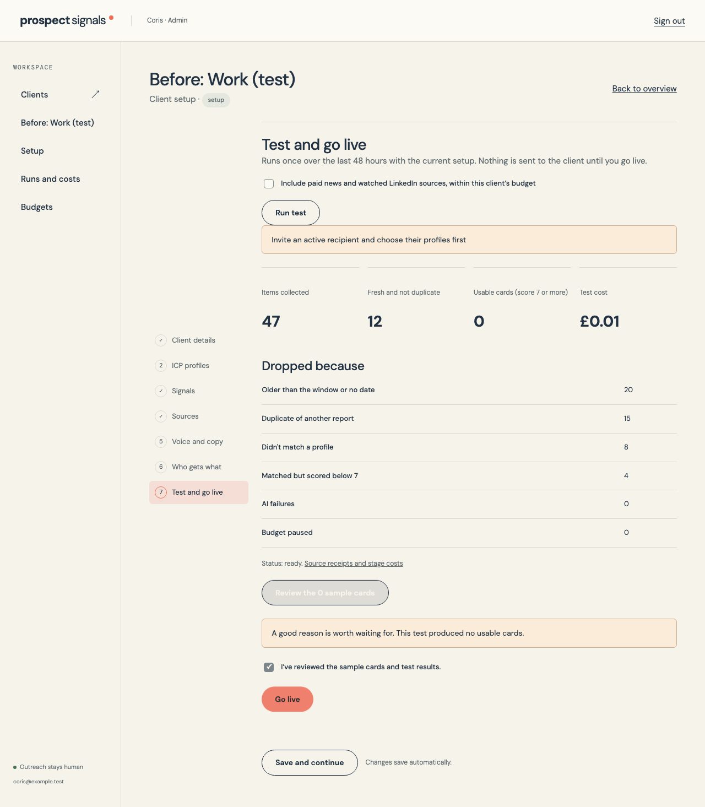
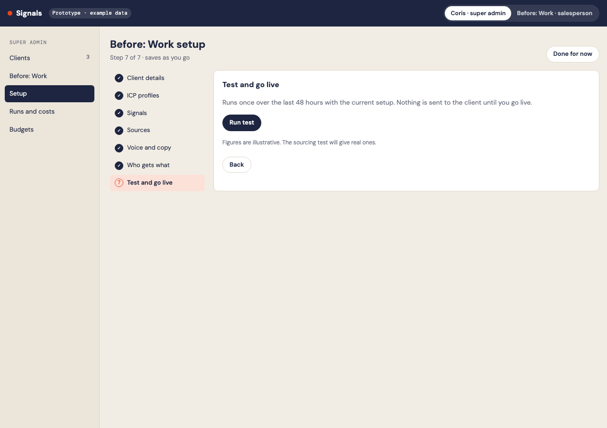
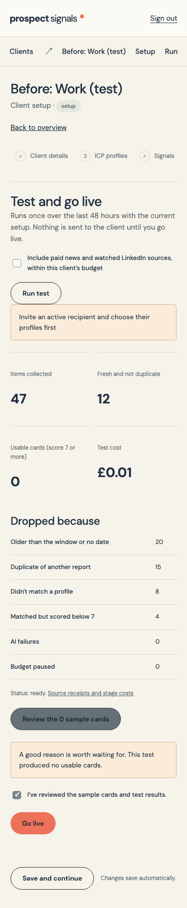
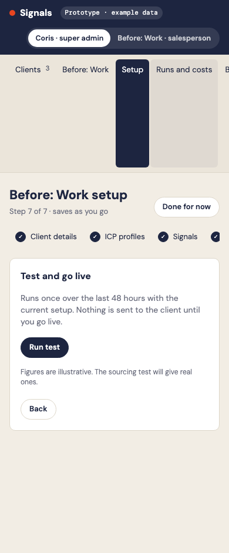

# Phase 7: Judge, match, write and review a test

Branch: `codex/signals-phase-7`, based on Phase 6.

The product pipeline uses cached fixed profile/rule/voice instructions, Haiku 5.5 triage and Sonnet 5.5 scoring through Anthropic Message Batches. Exact settings follow Coris's decisions in `docs/v2/product-decisions.md`. Truncated or refused responses are failures and are charged from actual usage without parsing partial JSON. Each stage records cache reads, token-limit failures and cost. A confirmed configuration rejection uses Sonnet's approved no-thinking-parameter / 1,500-token fallback. The live deadline is 30 minutes before the earliest enabled morning email; manual tests use a 15-minute deadline. A batch bootstrap request warms the shared cache before remaining requests, though batch cache hits are not guaranteed.

Every paid request reserves a conservative cold-cache maximum. A live fallback needs its own reservation while a batch charge is unresolved. Lost responses retain their reservation, and eventual costs settle once. Only the first valid result can become a card. Person matching prefers a source-named, title-qualified person, then a saved watch-list person in the profile's title order; LinkedIn URLs aren't guessed.

Sensitive events use the product-only fit track. Their delivery requires the client's Layoffs or restructure rule, a verified person and confirmed news; openers contain acknowledgment only. Delivery orders ordinary cards first, permits at most one sensitive card per recipient per day, and holds sensitive-only lists for admin review to enforce the never-first requirement. The sourcing experiment is untouched.

Setup step 7 runs an isolated test, shows drops/costs and sample openers, and requires explicit review. Go live checks current setup, real examples, recipient routes, approved watch list, budget and resolved AI calls. It schedules tomorrow's first collection in the client's timezone. No client is activated by a deployment.

## Prototype differences

- Paid collection is an explicit unchecked option for a manual test. AI judging still uses the budget gate.
- Results expose AI failures and budget pauses as well as the four requested drop categories. Failures cannot be silently treated as relevance drops.
- Fresh evidence already collected is reused and identified in the totals rather than purchased again.
- The Go live button stays disabled until results are reviewed and the server enforces readiness. An empty test is allowed to show its real zero cards; the system doesn't manufacture samples.
- Test cards show both opener tabs, source links and score. Client actions and version controls are added in Phase 8.
- First-list copy includes the actual weekday/time instead of assuming a particular local time.

## Screenshots

| Width | App | Prototype |
|---|---|---|
| 1280px |  |  |
| 390px |  |  |

## Validation

Local schema/RLS, budget settlement and core pipeline checks pass. The browser contract test exercises Run test, reviewed results and a rejected launch without an active recipient. It captures both widths without page overflow. Production deployment and a real provider test are recorded below after verification.

Pricing seeds were checked on 17 October 2026 against [Anthropic pricing](https://platform.claude.com/docs/en/about-claude/pricing), [batch processing](https://platform.claude.com/docs/en/build-with-claude/batch-processing) and [prompt caching](https://platform.claude.com/docs/en/build-with-claude/prompt-caching). Prices remain editable per client with currency, source and verification date. USD is converted with the saved ECB rate.

## Production verification in progress

Migration `20261017170906_signals_phase_seven.sql` and scheduler `20261017171100_signals_pipeline_scheduler.sql` are applied. `signals-pipeline` v3 and `signals-collect` v7 are active. Vercel deployment `dpl_3wecJfudo1NzDLaWf5KaNJHRaSvT` is Ready.

Real test `0c7e7a08-5d62-4beb-8554-d34301cd9ecd` reuses 45 still-fresh evidence items and buys no additional source data. Its first Haiku batch is queued with the provider. Provider completion, actual stage costs and cache reads remain to be verified. BEFORE:WORK remains in setup; no recipient emails are sent. Normal spend before judging is £0.168540; earlier fake budget charges are excluded.
