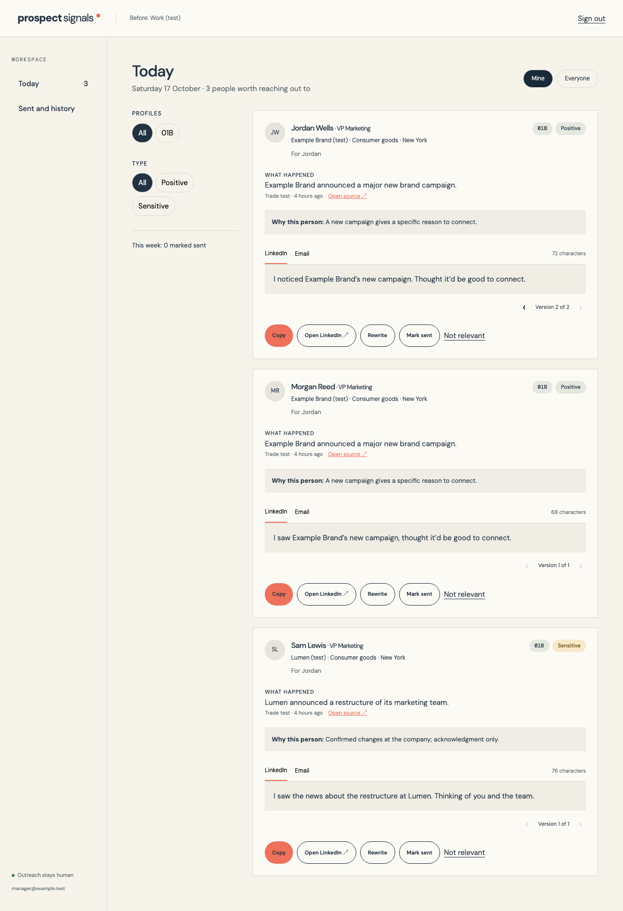
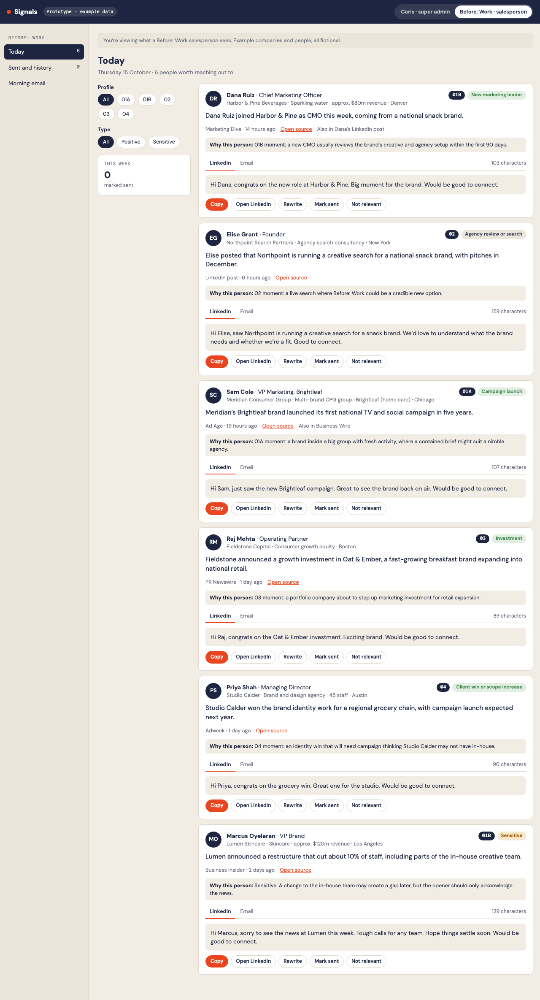
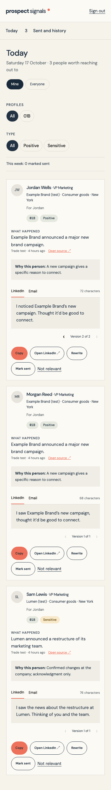
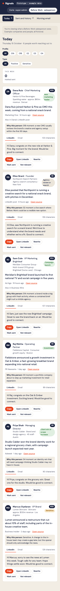
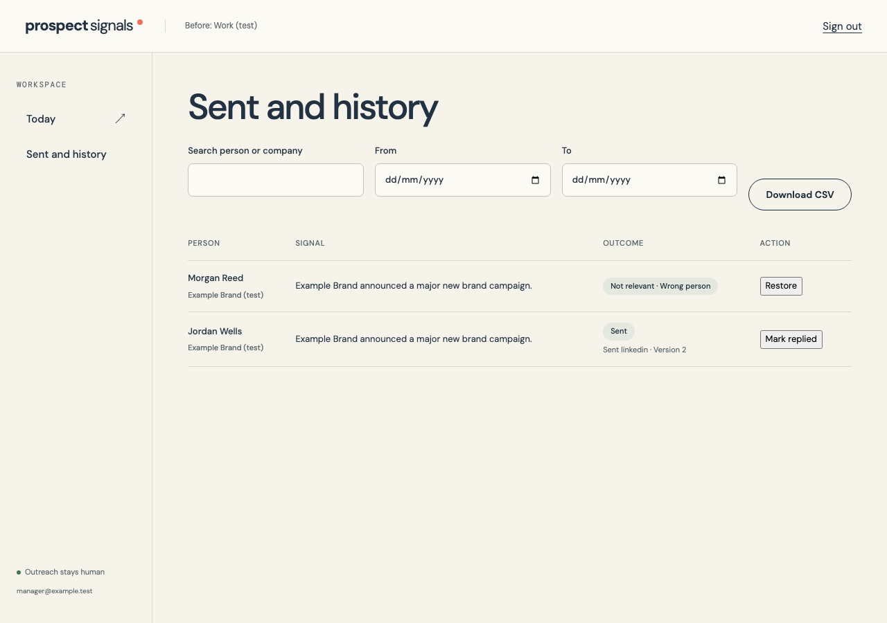
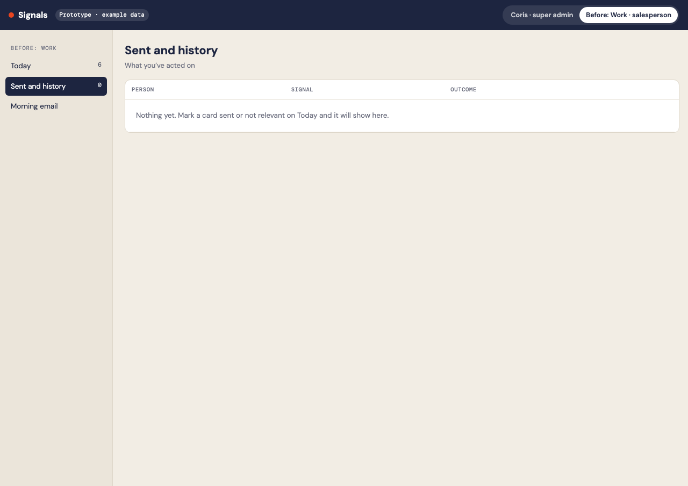
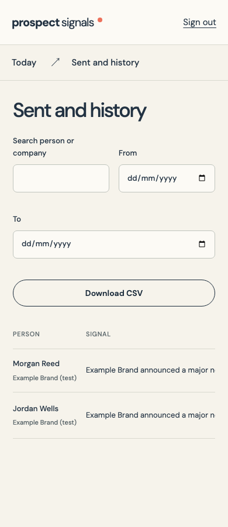
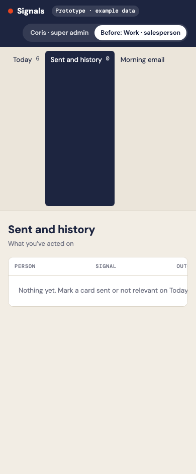

# Phase 8: Today, actions and history

Branch `codex/signals-phase-8`, based on Phase 7.

Today projects only the current recipient's fresh cards. Client admins can switch between mine and everyone; Coris's View as client opens everyone with a visible exit bar. Clients receive checked JSON projections rather than access to raw evidence, provider payloads or costs.

Each opener tab keeps its versions. Rewrite makes a live Sonnet 5.5 call with Stage 2 settings and voice, preserving the other tab. Copy and Mark sent use the visible draft ID, and history/CSV retain the version actually sent. Each card/tab allows three rewrite calls, including paid failures; every call reserves budget and settles its own cost. An uncertain response records the reserved cap as estimated rather than retrying a potentially charged request.

Not relevant saves a reason and optional note. Sent and dismissed cards leave Today, replies and restores update history, and all feedback records the real actor, including Coris in View as client. CSV is limited to platform/client admins, accepts a date range, and escapes spreadsheet formulas.

Find a person checks the profile's approved watch-list people first. A paid fallback needs a verified company LinkedIn page, current catalog pricing, an explicit estimate approval and budget reservation. It fetches one employer-filtered provider page and accepts only a matching company and priority title. No verified company page means no paid search. The card can't be marked sent until a person is found.

## Prototype differences

- Fresh AI rewrites replace the prototype's saved-alternative cycle, following Coris's decision. Arrows and version numbers preserve every generated version.
- Client admins have the brief's Mine / Everyone switch; salespeople don't.
- Missing LinkedIn URLs are stated plainly instead of opening a guessed profile.
- Feedback includes the prototype reasons plus the brief's Not a real event, Not our market, and Other with a note.
- A sensitive card never leads the default list. If all ordinary cards have been handled, remaining sensitive cards are held from the default list; the explicit Sensitive filter can still review them.
- Restore rejects an expired source instead of making old news appear fresh.
- Test previews now use the same card component, with actions disabled and the relevance score shown.
- The source-only Runs table now merges judged source totals and stage costs. Sensitive admin-only judgments appear in the run's log.
- A minute worker tick and bounded parallel fallback groups allow normal API calls to progress before morning email. Provider latency and rate limits can still leave failures visible; no weak cards are added to fill the list.

## Screenshots

| View | 1280px app / prototype | 390px app / prototype |
|---|---|---|
| Today |   |   |
| History |   |   |

## Validation

Schema checks cover cross-client access, salesperson/everyone restrictions and the exact sent draft version. Browser checks exercise rewrite navigation, sent, feedback, reply, restore and admin CSV access. Paired screenshots use fictional local fixtures, with no external email or paid model call.
